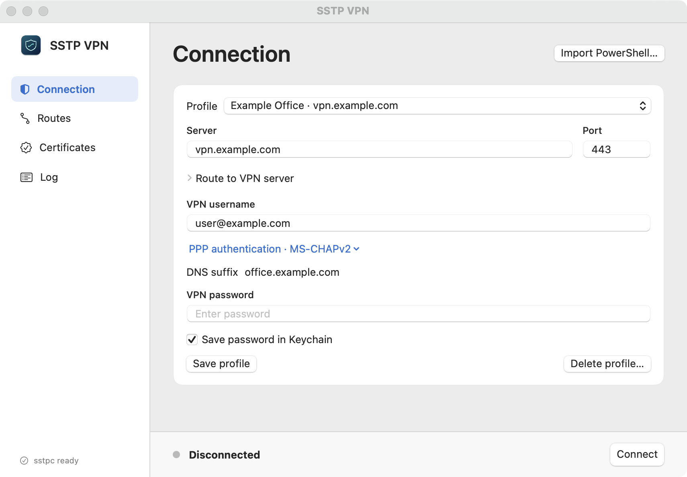
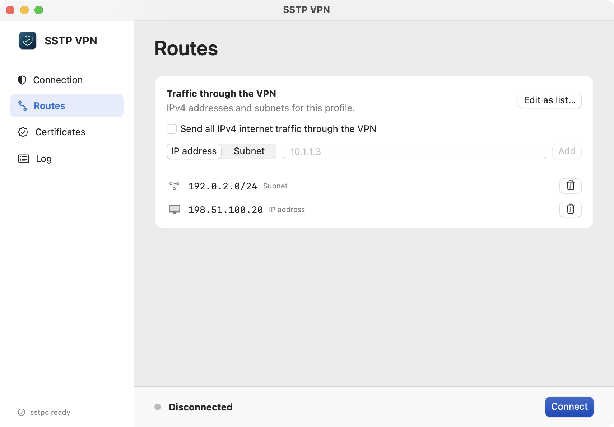
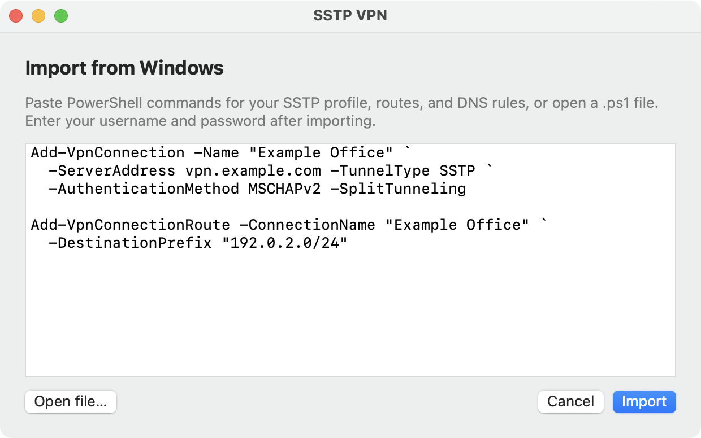

# SSTP VPN for macOS

[Читать по-русски](README.ru.md)

A native macOS client for SSTP VPNs using PPP authentication. The Universal app runs on Apple Silicon and Intel with macOS 15 or later. It includes a modified build of the open-source `sstpc` client and uses the system `pppd`. English and Russian are available through macOS per-app language settings.



| Routes | PowerShell import |
| --- | --- |
| [](docs/screenshots/routes-en.png) | [](docs/screenshots/import-en.png) |

These screenshots show the bilingual development build with a sample profile.

## Install and connect

1. Download the Universal ZIP from Releases, extract it, and move `SSTP VPN.app` to Applications. The ZIP includes the license and dependency notices.
2. Open the app, then enter your server and credentials or choose **Import PowerShell…** to import a Windows VPN profile.
3. Click **Connect** and approve the macOS administrator prompt for the network helper. The app manages and disconnects its tunnel directly.

To choose an app language, open **System Settings → General → Language & Region → Applications**. Add **SSTP VPN**, select English or Russian, and reopen the app. [Apple Support](https://support.apple.com/guide/mac-help/mh26684/mac)

Local builds use ad hoc signing by default. If macOS blocks a downloaded build, review the download and its checksum before following Apple’s instructions for opening an app from an unidentified developer. [Apple Support](https://support.apple.com/en-us/102445)

## Windows profile import

Paste PowerShell configuration commands or select a `.ps1` or `.txt` file. The importer reads named and positional arguments, literal variables, arrays, and parameter hashtables. A script can use `Set-VpnConnection` and add, change, or remove imported routes and DNS rules after defining the profile.

```powershell
Add-VpnConnection -Name Office -ServerAddress vpn.example.com -TunnelType SSTP -AuthenticationMethod MSCHAPv2 -EncryptionLevel Optional -SplitTunneling -RememberCredential -DnsSuffix corp.example.com
Add-VpnConnectionRoute -ConnectionName Office -DestinationPrefix "192.0.2.0/24"
Add-VpnConnectionTriggerDnsConfiguration -ConnectionName Office -DnsSuffix "corp.example.com" -DnsIPAddress "192.0.2.53"
```

Enter your username and password after import. The app can remember the password in the macOS Keychain. To update routes and DNS for an existing profile, import the same name and server again. To delete a profile, select it and choose **Delete profile…**.

Supported authentication choices are MS‑CHAPv2, CHAP (MD5) and PAP. You can specify several with `-AuthenticationMethod` or choose them from the PPP menu. MS‑CHAPv2 is the default. CHAP and PAP require `-EncryptionLevel Optional` or `NoEncryption` when used without MS‑CHAPv2. The SSTP transport uses TLS for each method. EAP profiles, PowerShell expressions and settings specific to other VPN protocols result in an import error with the line number.

## Routes and DNS

- **Split tunnel** sends the routes in the **Routes** tab through the VPN. Add individual IPv4 hosts or CIDR networks. For a Windows import, `-SplitTunneling` selects this mode.
- **Full tunnel** sends internet-bound IPv4 traffic through the VPN and temporarily blocks ordinary IPv6 internet routes. More specific routes still take precedence. Full tunnel requires an available system default route and VPN server internet forwarding to change your public IPv4. A tunnel route scoped to its own interface does not prevent connecting.
- `-DnsSuffix` sets a search domain and uses VPN-provided DNS for that domain. Explicit DNS rules from `Add-VpnConnectionTriggerDnsConfiguration` apply after connecting. The app removes its DNS settings on disconnect. Imported Windows route metrics have no effect on macOS.

## Server trust and diagnostics

The default **macOS system trust** mode validates the server name and TLS certificate chain using macOS trust settings. For a private certificate authority, select **Custom CA bundle** in **Certificates** and import its root and any required intermediates in PEM or DER format. This local bundle can be updated or replaced and is shared by profiles that select it.

**Log** shows connection progress through DNS, IPv4 routing, TCP, TLS, SSTP, PPP authentication, and IPCP. Full tunnel has an optional internet check that makes HTTPS requests to Cloudflare. The app closes its tunnel when you quit. `-IdleDisconnectSeconds` sets the PPP idle timeout for an imported connection.

## Build from source

Install Command Line Tools for Xcode with `xcode-select --install`, then run `./build.sh`. The output is `build/SSTP VPN.app`. The first build compiles OpenSSL and libevent for both architectures from the checksum-verified source archives in `Engine/Vendor`. Set `SSTP_SIGN_IDENTITY` to choose a macOS code signing identity.

The sstp-client changes are in `Engine/macos.patch` and `Engine/sstp-macos-trust.h`. The application bundle includes the dependencies’ license texts. [sstp-client](https://gitlab.com/sstp-project/sstp-client) · [OpenSSL](https://www.openssl-library.org/) · [libevent](https://libevent.org/)

## Compatibility checks

Run `Tests/check-import.sh` to check profile import. Set `SSTP_TEST_OPENSSL` to the path to an OpenSSL 3 executable and run `python3 Tests/sstp_peer.py 'build/SSTP VPN.app/Contents/MacOS/sstpc'` to test macOS trust against a loopback TLS peer. With administrator privileges, `--ppp` also checks positive and negative password cases, SSTP Crypto Binding and IPv4 IPCP through the system `pppd`. The fixture uses test certificates, loopback TCP, and documentation IPv4 ranges for PPP.

## License

SSTP VPN for macOS is available under GPL‑3.0‑or‑later. The upstream sstp-client sources retain their GPL‑2.0‑or‑later notices. This distribution builds the modified engine under GPLv3 or later and links it with OpenSSL (Apache‑2.0) and libevent (BSD‑3‑Clause). See [LICENSE](LICENSE) and the notices in the dependency archives and application bundle.
