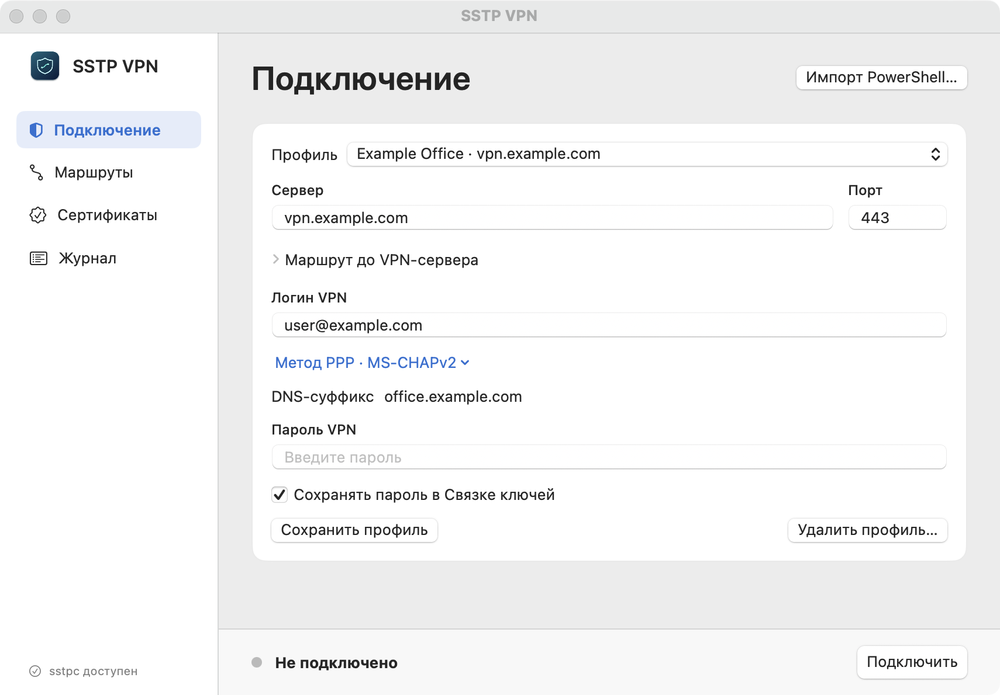
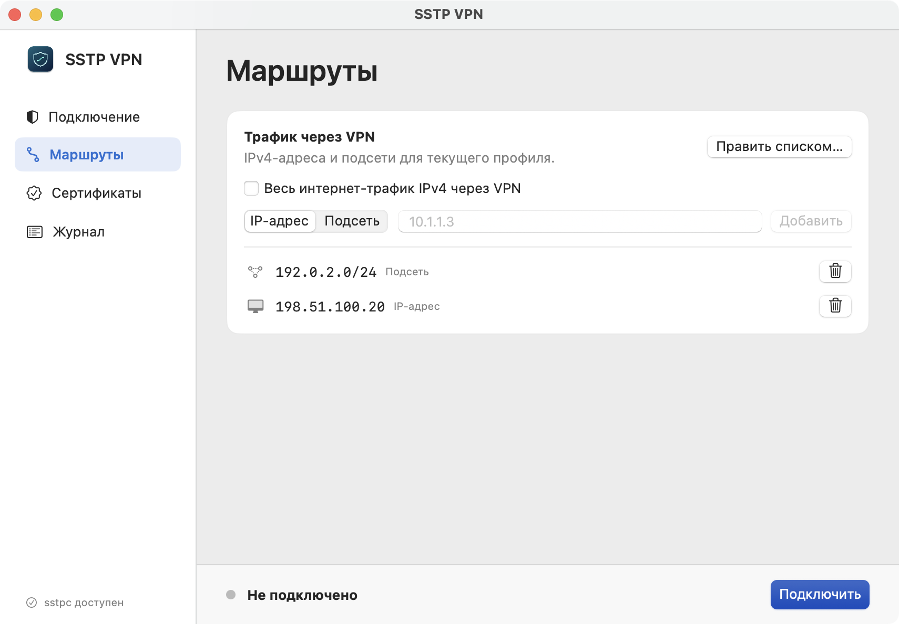
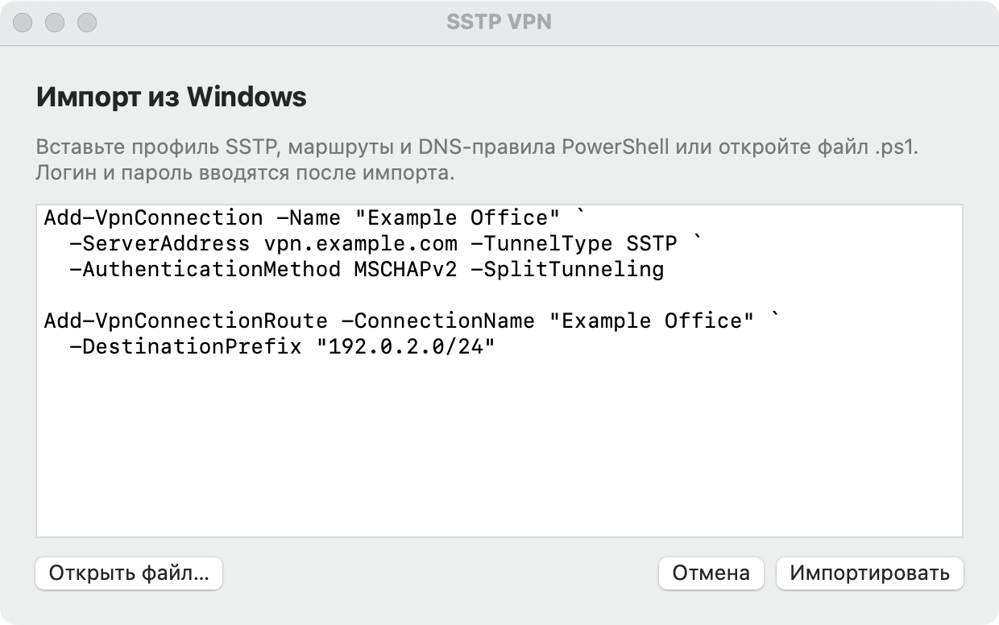

# SSTP VPN для macOS

[Read in English](README.md)

Клиент для подключения к SSTP VPN на macOS 15 и новее. Приложение собрано для Apple Silicon и Intel. В комплект уже входит открытый клиент `sstpc`, а для PPP используется системный `pppd`.



| Маршруты | Импорт PowerShell |
| --- | --- |
| [](docs/screenshots/routes-ru.png) | [](docs/screenshots/import-ru.png) |

На скриншотах показан русский интерфейс с демонстрационным профилем.

## Установка и первый запуск

1. Скачайте Universal ZIP на странице [Releases](https://github.com/poseydonskiyy/sstp-vpn-macos/releases), распакуйте архив и переместите `SSTP VPN.app` в «Программы».
2. Укажите сервер и учётные данные или нажмите «Импорт PowerShell…», чтобы перенести настройки с Windows.
3. Нажмите «Подключить» и подтвердите системный запрос администратора, чтобы запустить сетевой компонент.

Русский и английский интерфейсы выбираются в **Системные настройки → Основные → Язык и регион → Программы**. Добавьте SSTP VPN в список, выберите язык и откройте приложение заново. [Руководство Apple](https://support.apple.com/ru-ru/guide/mac-help/mh26684/mac)

Публичная сборка подписана ad hoc. Если macOS останавливает запуск и вы доверяете источнику, проверьте контрольную сумму ZIP и следуйте инструкции Apple. [Инструкция Apple](https://support.apple.com/ru-ru/102445)

## Перенос профиля из Windows

Вставьте команды или откройте файл `.ps1`. Импорт читает именованные и позиционные аргументы, переменные с готовыми значениями, массивы и таблицы параметров. Можно создавать и обновлять профиль, добавлять и удалять маршруты, менять правила DNS.

```powershell
Add-VpnConnection -Name "Example Office" -ServerAddress vpn.example.com -TunnelType SSTP -AuthenticationMethod MSCHAPv2 -EncryptionLevel Optional -SplitTunneling -DnsSuffix office.example.com
Add-VpnConnectionRoute -ConnectionName "Example Office" -DestinationPrefix "192.0.2.0/24"
Add-VpnConnectionTriggerDnsConfiguration -ConnectionName "Example Office" -DnsSuffix "office.example.com" -DnsIPAddress "192.0.2.53"
```

После импорта введите логин и пароль. Пароль можно сохранить в Связке ключей. Для обновления профиля импортируйте команды с теми же именем и сервером. Поддерживаются MS‑CHAPv2, CHAP (MD5) и PAP. Метод входа и шифрование PPP доступны в меню профиля. Все три метода работают внутри TLS. При импорте профиля EAP приложение покажет строку и причину, по которой его пока нельзя использовать. [Командлеты Microsoft VpnClient](https://learn.microsoft.com/powershell/module/vpnclient/)

## Маршруты и проверка подключения

- В раздельном режиме через VPN идут указанные IPv4-адреса и подсети. Для импорта из Windows режим включает параметр `-SplitTunneling`.
- В полном режиме интернет-трафик IPv4 идёт через VPN. Сервер должен выпускать этот трафик в интернет, чтобы изменился внешний IP. Обычные исходящие маршруты IPv6 временно блокируются.
- DNS-суффикс и адреса DNS можно перенести из PowerShell. Правила применяются при подключении и удаляются при отключении.
- По умолчанию имя сервера и цепочку TLS проверяет macOS. Для частного центра сертификации выберите пользовательский комплект CA и импортируйте корневой и нужные промежуточные сертификаты.
- Журнал показывает по этапам DNS, маршрут до сервера, TCP, TLS, SSTP, аутентификацию PPP и получение IPv4. В полном режиме можно включить отдельную HTTPS-проверку доступа в интернет.

Инструкции по сборке и тестированию есть в [английском README](README.md#build-from-source). Исходники доступны под [GPL‑3.0‑or‑later](LICENSE).
